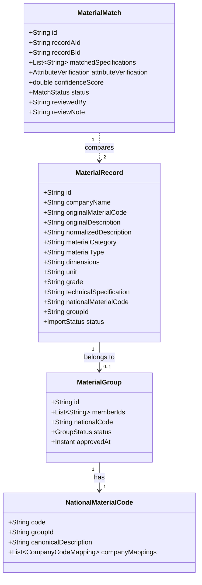

# MATRIQ — Architecture Specification
## Intelligent Material Code Harmonization Engine

```
       ┌────────────────────────────────────────────────────────┐
       │                CSV INGESTION ENGINE                    │
       │  (CPCL, IOCL, ONGC, BPCL, SAIL Multi-Format Datasets)   │
       └───────────────────────────┬────────────────────────────┘
                                   │
                                   ▼
       ┌────────────────────────────────────────────────────────┐
       │            DATA NORMALIZATION PIPELINE                 │
       │   - Abbreviation Expansion via Prefix Trie             │
       │   - Unit Standardization (Explicit Tolerances)         │
       │   - Preservation of Original Identifiers & Raw Text    │
       └───────────────────────────┬────────────────────────────┘
                                   │
                                   ▼
       ┌────────────────────────────────────────────────────────┐
       │             BLOOM FILTER PRE-SCREENING                 │
       │   - O(k) signature membership check                    │
       │   - Zero false negatives guaranteed                    │
       │   - False-positive tracking & optimal bit tuning       │
       └───────────────────────────┬────────────────────────────┘
                                   │
                                   ▼
       ┌────────────────────────────────────────────────────────┐
       │               KMP SPECIFICATION MATCHER                │
       │   - O(n + m) Longest Prefix Suffix (LPS) scan          │
       │   - Technical standard locator (ASTM, API, ANSI, IS)   │
       │   - Character comparison instrumentation               │
       └───────────────────────────┬────────────────────────────┘
                                   │
                                   ▼
       ┌────────────────────────────────────────────────────────┐
       │           ATTRIBUTE VERIFICATION GATE (HARD GATE)      │
       │   - Category & Material Type check                     │
       │   - Strict Dimension conversion (e.g. 6" == 150mm ±2%) │
       │   - Grade compatibility (e.g. Gr.B == A106-B != SS316) │
       │   - Unverified pairs discarded (NEVER merged)          │
       └───────────────────────────┬────────────────────────────┘
                                   │
                                   ▼
       ┌────────────────────────────────────────────────────────┐
       │              DISJOINT SET UNION (DSU)                  │
       │   - Path Compression + Union by Size: O(α(n))          │
       │   - Transitive cross-company clustering                │
       │   - Rebuild-on-rejection consistency guarantee         │
       └───────────────────────────┬────────────────────────────┘
                                   │
                                   ▼
       ┌────────────────────────────────────────────────────────┐
       │             NATIONAL CODE REGISTRY                     │
       │   - Deterministic NMC issuance: NMC-YYYY-XXXXXXXX      │
       │   - Preserves all original organization codes          │
       │   - Audit-ready provenance trail & export engine       │
       └────────────────────────────────────────────────────────┘
```

---

## 1. Monorepo Organization

```
matriq-material-harmonization/
├── backend/
│   ├── pom.xml                                      # Maven Spring Boot configuration
│   └── src/
│       ├── main/java/com/matriq/
│       │   ├── MatriqApplication.java               # Application bootstrap
│       │   ├── algorithms/
│       │   │   ├── bloom/BloomFilter.java           # CO5 Bloom Filter implementation
│       │   │   ├── trie/MaterialTrie.java           # Prefix lookup & abbreviation engine
│       │   │   ├── kmp/KMPMatcher.java              # O(n+m) KMP with comparison metrics
│       │   │   ├── kmp/KMPResult.java               # KMP result container
│       │   │   ├── kmp/KMPTracer.java               # Step-by-step execution tracer for UI
│       │   │   └── dsu/DisjointSetUnion.java        # O(α(n)) Union-Find with path compression
│       │   ├── model/                               # Domain models & entities
│       │   ├── repository/                          # Concurrent thread-safe in-memory stores
│       │   ├── normalization/                       # Text, unit & standard normalization
│       │   ├── matching/                            # Attribute verification & candidate screening
│       │   ├── harmonization/                       # Pipeline coordinator & DSU manager
│       │   └── controller/                          # REST controllers
│       └── test/java/com/matriq/                    # 32+ automated JUnit 5 tests
├── frontend/
│   ├── src/
│   │   ├── components/                              # Reusable architectural UI components
│   │   ├── pages/                                   # 8 full application views
│   │   └── services/                                # Typed API client layer
├── data/
│   ├── sample/                                      # Demonstrator CSV files (CPCL, IOCL, ONGC)
│   └── generated/                                   # 100+ record synthetic multi-organization dataset
└── docs/                                            # Complete technical & viva documentation
```

---

## 2. Core Domain Data Model



---

## 3. Strict Verification & Integrity Safeguards

1. **Original Identity Preservation:** Original company material codes (e.g., `PIPE-001`, `P-9281`) are never overwritten. The `nationalMaterialCode` is added as an umbrella identifier alongside the original attributes.
2. **Deterministic National Identifiers:** Format: `NMC-{YEAR}-{SEQUENCE_8_DIGITS}`. Group identifiers are generated deterministically and remain stable across re-evaluations.
3. **No Automatic False Grouping:** Neither a Bloom filter hit nor a KMP specification match alone permits grouping. Records must pass the hard multi-attribute gate.
4. **Rebuild on Rejection:** If a reviewer rejects a proposed link, the engine recomputes the DSU graph from remaining approved edges, preventing false transitivities.
